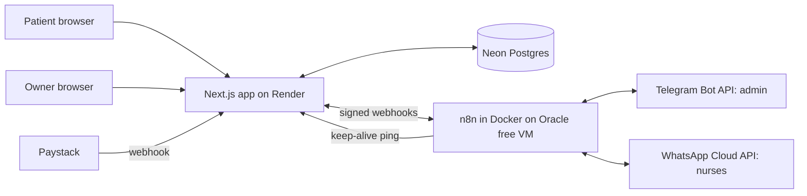

# 02 - Architecture

Status: APPROVED · 2026-11-25 · Phase 3. Decisions are in `docs/decisions/`.

## 1. Shape: one web app + n8n (ADR-001, ADR-002)

The Next.js app owns all data and business rules. n8n only does messaging (Telegram, WhatsApp) and timers, and calls the app through secured internal endpoints.



## 2. Data model (main entities)

| Entity | Key fields |
|---|---|
| User | id, role (patient/owner), name, phone (unique), sex, age, password hash |
| Admin | telegram_id, name, added_by |
| Nurse | whatsapp_number (unique), name, active, approved_by |
| Test | id, name, price, active (includes "General sample collection") |
| Booking | id, booking_code, user, visit_type (home/walk-in), location_link, total, status, expires_at |
| BookingItem | booking, test, price at booking time |
| Payment | booking, method (paystack/transfer), reference, status, receipt (file) |
| StatusEvent | booking, from, to, actor, time |
| DispatchOffer | booking, nurse, sent_at, reply, replied_at |
| Result | booking, lab_no, specimen, examination_required, values (JSON), comment, pdf (file) |
| SelarLink | title, url, position |
| NewsItem | title, url, source, published_at (cached) |
| SystemEvent | type (error/delivery_failure/webhook), source, detail, time (feeds the dashboard) |

Status values: Booked, Paid, Nurse Dispatched, Sample Collected, Result Ready, Expired. Files (receipts, PDFs) are stored in Postgres (ADR-007) because Render's free disk is wiped on restart.

## 3. API outline

- **Patient (login required):** register, login, logout, list catalog, create booking, my bookings, upload receipt, start Paystack payment, download my result.
- **Public:** catalog, news, Selar links.
- **Paystack webhook:** `POST /api/webhooks/paystack` (signature checked).
- **Internal, for n8n only (shared secret + signature):** admin and nurse authorisation checks, confirm transfer, expire bookings, record nurse reply/assignment, set status, submit result, add/remove nurse, edit tests/links, add admin/owner, log system event, health report.
- **Owner (login, role owner):** read-only dashboard data.

## 4. Timers and rules

- **10-minute transfer expiry:** `expires_at` stored on the booking. The app treats it as expired on read, and n8n also sweeps every minute and tells the admin.
- **5-minute nurse window:** n8n sends offers; the first YES is accepted by an app endpoint that assigns atomically (only one nurse can win).
- **Keep-alive:** n8n pings the app every 10 minutes (window is a setting) because Render's free service sleeps after 15 minutes and takes about a minute to wake. Pinging all day uses about 720 of the 750 free monthly hours, so the default window is 06:00 to 22:00 (about 480 hours).

## 5. Security

- Only approved Telegram accounts (Admin) and approved WhatsApp numbers (Nurse) are obeyed; everyone else is ignored.
- n8n and the app trust each other only through a shared secret and signed requests.
- A patient can only read their own bookings and results. Passwords hashed. No secrets in the repo; only `.env.example`.
- Results are health data: HTTPS everywhere, private downloads (never public links), and access logged.

## 6. Folder structure

```
/ (repo root)
├── CLAUDE.md
├── docs/
├── app/            # Next.js routes (pages, api)
├── components/     # UI components (shadcn/ui based)
├── lib/            # db, auth, status rules, pdf, n8n client
├── prisma/         # schema and migrations
├── pdf/            # result form template (react-pdf) + sample fixtures
├── n8n/            # exported workflow JSON + docker-compose.yml
└── tests/          # unit, integration, e2e
```

## 7. Accounts you will need to create

GitHub, Neon, Render, Telegram bot (via BotFather), Paystack, Oracle Cloud, and a Meta developer/WhatsApp Business account. M1 only needs the first four.
